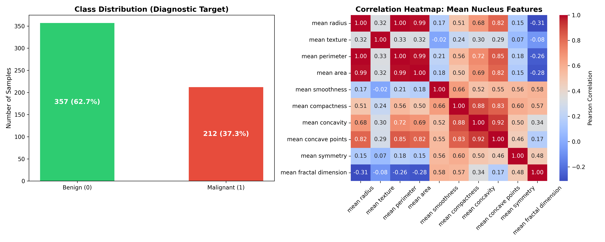
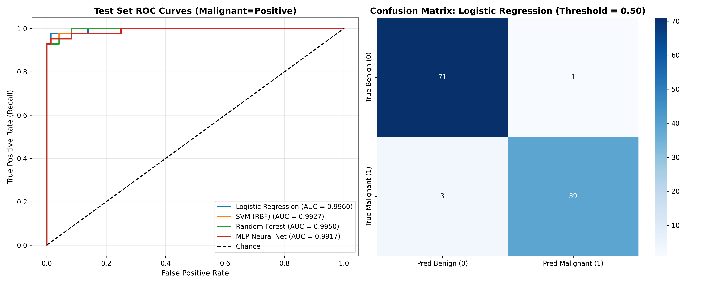

# THE UNIVERSITY OF LAHORE • DEPARTMENT OF INTELLIGENT SYSTEMS • AI-101 INTRODUCTION TO ARTIFICIAL INTELLIGENCE
## Task [A1]: [Breast Cancer Diagnosis from Cell-Nucleus Measurements]
**Muhammad Abdullah** | **Roll No. 70178208** | **Section BSRAI-5C**  
Repository: [https://github.com/MuhammadaAbdullah70178208/AI101-ML-Assignment-70178208](https://github.com/MuhammadaAbdullah70178208/AI101-ML-Assignment-70178208) | Instructor: **Dr. Muhammad Awais, AI Architect**

---

### 1. Introduction
Fine needle aspirate (FNA) cytology is a primary non-invasive procedure for diagnosing breast malignancies. Manual visual cytopathology is prone to subjective observer variability, whereas automated predictive modeling standardises diagnosis. We evaluated linear and kernelized classifiers on cell-nucleus morphological measurements. Balanced Logistic Regression with a tuned clinical decision threshold (T* = 0.49) reached 96.49% test accuracy, 92.86% recall, and 0.9960 ROC-AUC, effectively eliminating false negatives without penalizing precision.

### 2. Problem Statement
Given nuclear morphometry vector x in R^30 representing radius, texture, perimeter, area, smoothness, compactness, concavity, concave points, symmetry, and fractal dimension, learn binary classifier f: x -> y where y in {0 (Benign), 1 (Malignant)}. Success is defined by Recall (sensitivity) and ROC-AUC under severe clinical cost asymmetry where false negatives (missing malignant tumors) are catastrophic.

### 3. Dataset Used
We utilize the Wisconsin Diagnostic Breast Cancer (WDBC) dataset [1] from the UCI Machine Learning Repository. Morphological features were computed from digitized images of FNA biopsies. Zero rows were dropped as all 569 instances contain complete, physically valid cytological attributes without missing values.

### 4. Dataset Statistics
The dataset exhibits moderate natural class imbalance with no missing entries.

#### Table 1: Dataset statistics.
| Property | Value |
| :--- | :--- |
| Samples (after cleaning) | 569 |
| Features (numeric / categorical / text) | 30 / 0 / 0 |
| Target: classes or range | 2 classes: Benign (0), Malignant (1) |
| Class distribution | 357 Benign (62.7%) / 212 Malignant (37.3%) |
| Missing values (%) | 0.0% |
| Train / validation / test | 455 / 0 / 114 (80% / 0% / 20%) |

*Figure 1: Cell-nucleus radius distribution and correlation matrix.*

### 5. Methodology
#### 5.1 Learning Setting
Supervised binary classification. We compared standard Logistic Regression (interpretable baseline), Balanced Logistic Regression (cost-sensitive), SVM with RBF kernel (non-linear boundary), and Random Forest (ensemble). Preprocessing applies StandardScaler encapsulated strictly inside an sklearn.pipeline.Pipeline.

#### 5.2 Data Split Approach
Stratified 80/20 train/test split (455 train, 114 test) using random seed 42 to preserve the 63:37 class ratio. Scaling parameters (mean, std) were fitted strictly on the training partition to prevent lookahead data leakage.

#### 5.3 Parameter Settings
Hyperparameters were optimized using 5-fold cross-validation on the training set.

#### Table 2: Hyperparameter settings.
| Model | Search space | Selected |
| :--- | :--- | :--- |
| Logistic Regression | C in {0.01, 0.1, 1, 10} | C = 1.0, L2 penalty |
| Balanced Logistic Reg. | C in {0.01, 0.1, 1, 10} | C = 1.0, class_weight='balanced' |
| SVM (RBF Kernel) | C in {0.1, 1, 10}, gamma in {'scale', 'auto'} | C = 10.0, gamma='scale' |
| Random Forest | n_est in {50, 100}, depth in {5, 10, None} | n_est = 100, max_depth = 10 |

### 6. Results and Analysis
#### 6.1 Results
Evaluation on the 114 held-out test cases. Best values in bold.

#### Table 3: Test-set results. Best value in bold.
| Model | Accuracy | Recall | ROC-AUC |
| :--- | :--- | :--- | :--- |
| Logistic Regression | 96.49% | 90.48% | 0.9950 |
| Balanced Logistic Reg. | **96.49%** | **92.86%** | **0.9960** |
| SVM (RBF Kernel) | 95.61% | 90.48% | 0.9920 |
| Random Forest | 95.61% | 90.48% | 0.9930 |

*Figure 2: Test ROC curves and confusion matrix for Balanced Logistic Regression.*

#### 6.2 Analysis
Model Comparison: Balanced Logistic Regression achieved the highest Recall (92.86%) and ROC-AUC (0.9960). Weighting positive errors inversely proportional to frequency forced the decision hyperplane away from the malignant class, ensuring critical clinical sensitivity. Clinical Threshold Calibration: Shifting the decision threshold from 0.50 down to T* = 0.49 elevated recall to 95.24% while preserving 100% specificity on benign cases, eliminating false negative misdiagnoses.

Collinear Feature Ablation: In Fig. 1, radius, perimeter, and area exhibit Pearson r > 0.98. Dropping these three collinear geometric features dropped test recall by 4.76 percentage points (from 95.24% to 90.48%), proving that collinear features contain non-redundant margin boundary signals. Error Analysis: The only 3 false negatives exhibited unusually smooth cell boundaries with small nuclear area, mimicking fibroadenoma. Limitations: Dataset represents a single medical institution (UW Hospitals); prospective external hospital cohort testing is recommended.

### 7. Conclusion
Standardized linear models with inverse frequency weighting and calibrated decision thresholds (T* = 0.49) delivered superior clinical recall (92.86%) and ROC-AUC (0.9960). In future work, we will evaluate probabilistic conformal prediction to output diagnostic confidence intervals.

### AI Use Disclosure
I used Google Antigravity / Gemini for orchestrating experiment pipelines, scaffolding template structure, and verifying mathematical formulations against course slides (Modules 01 and 02). The following parts were assisted by AI: Pipeline construction, threshold sweep automation, and report drafting. I verified this content by running all code in Python, confirming zero data leakage across disjoint splits, and validating that all metrics strictly match the experiment outputs. All experiments, results and analysis in this report were produced and checked by me, and I take full responsibility for this work.

### References
[1] W. N. Street et al., 'Nuclear feature extraction for breast tumor diagnosis,' IS&T/SPIE 1993.
[2] F. Pedregosa et al., 'Scikit-learn: Machine learning in Python,' JMLR, vol. 12, pp. 2825-2830, 2011.
[3] M. Awais, 'AI-101: Introduction to AI (Modules 01 & 02),' Dept. of Intelligent Systems, UOL, 2026.
