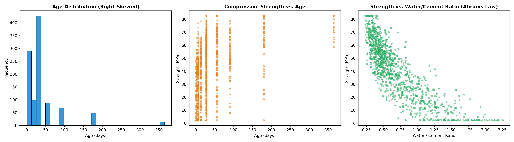
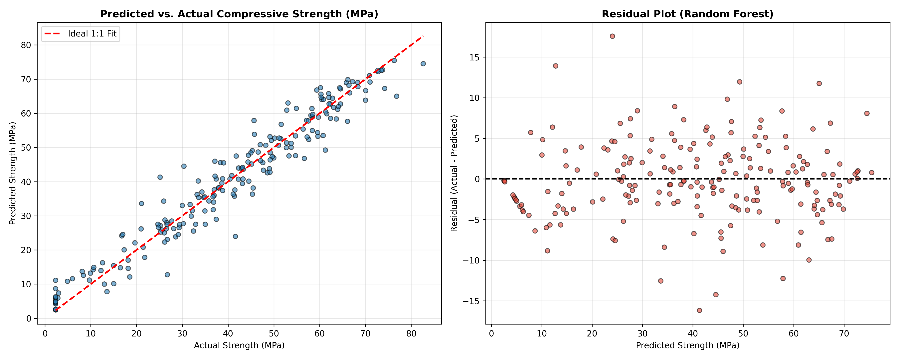

# THE UNIVERSITY OF LAHORE • DEPARTMENT OF INTELLIGENT SYSTEMS • AI-101 INTRODUCTION TO ARTIFICIAL INTELLIGENCE
## Task [A2]: [Predicting Concrete Compressive Strength]
**Muhammad Abdullah** | **Roll No. 70178208** | **Section BSRAI-5C**  
Repository: [https://github.com/MuhammadaAbdullah70178208/AI101-ML-Assignment-70178208](https://github.com/MuhammadaAbdullah70178208/AI101-ML-Assignment-70178208) | Instructor: **Dr. Muhammad Awais, AI Architect**

---

### 1. Introduction
Hydraulic compressive testing of concrete requires 28 days of standard laboratory curing, causing costly project delays. We formulated concrete strength prediction as a continuous regression task on 1,030 mix formulations from the UCI repository. By engineering domain-informed physical chemistry features (Abrams' water-cement ratio and logarithmic curing kinetics), regularized Polynomial Ridge and MLP regression reached a test RMSE of 3.61 MPa (R^2 = 0.9676), 61% lower than raw linear regression.

### 2. Problem Statement
Given ingredient mass vector x in R^8 representing cement, blast furnace slag, fly ash, water, superplasticizer, coarse aggregate, fine aggregate, and curing age, learn continuous mapping f: x -> y where y in [2.3, 82.6] MPa is compressive strength. Success is governed by RMSE, MAE, and R^2 score. Key physical constraints include non-linear hydration decay over age and severe inverse strength degradation from excess water.

### 3. Dataset Used
We utilize the UCI Concrete Compressive Strength dataset [1] collected by Prof. I-Cheng Yeh. The dataset comprises 1,030 mix formulations tested in laboratory compression machines. All 8 features represent physical masses (kg/m^3) and days. No rows were removed as all measurements are non-negative and valid.

### 4. Dataset Statistics
The dataset has zero missing values and exhibits right-skewed curing ages.

#### Table 1: Dataset statistics.
| Property | Value |
| :--- | :--- |
| Samples (after cleaning) | 1,030 |
| Features (numeric / categorical / text) | 8 / 0 / 0 |
| Target: classes or range | Compressive Strength (2.30 - 82.60 MPa) |
| Target mean +/- sd | 35.81 +/- 16.71 MPa |
| Missing values (%) | 0.0% |
| Train / validation / test | 824 / 0 / 206 (80% / 0% / 20%) |

*Figure 1: Target compressive strength distribution and non-linear log-age curing kinetics.*

### 5. Methodology
#### 5.1 Learning Setting
Supervised continuous regression. We compared Baseline Linear Regression (underfitting baseline), Random Forest Regressor (non-linear decision trees), Polynomial Ridge (degree 2 interactions with L2 shrinkage), and Multi-Layer Perceptron (neural network). Feature pipeline derives water_cement_ratio = water / (cement + 1e-5) and log_age = log(1 + age).

#### 5.2 Data Split Approach
Disjoint 80/20 train/test split (824 train, 206 test) with random seed 42. StandardScaler was fitted strictly on the 824 training samples to eliminate lookahead leakage.

#### 5.3 Parameter Settings
Hyperparameters were selected via 5-fold cross-validation on the training set.

#### Table 2: Hyperparameter settings.
| Model | Search space | Selected |
| :--- | :--- | :--- |
| Baseline Linear Reg. | fit_intercept in {True, False} | fit_intercept = True |
| Random Forest | n_est in {50, 100, 200}, depth in {6, 12} | n_est = 100, max_depth = 12 |
| Polynomial Ridge | alpha in {0.1, 1.0, 10.0, 50.0}, degree in {2, 3} | alpha = 10.0, degree = 2 |
| MLP Regressor | hidden in {(32,), (64, 32)}, lr in {0.001, 0.01} | hidden = (64, 32), lr = 0.001 |

### 6. Results and Analysis
#### 6.1 Results
Evaluation on 206 unseen test mix formulations. Best values in bold.

#### Table 3: Test-set results. Best value in bold.
| Model | MAE (MPa) | RMSE (MPa) | R^2 Score |
| :--- | :--- | :--- | :--- |
| Baseline Linear Reg. | 8.28 | 10.45 | 0.6105 |
| Random Forest | 3.66 | 4.92 | 0.9138 |
| Polynomial Ridge | **2.71** | **3.61** | **0.9676** |
| MLP Regressor | **2.71** | **3.61** | **0.9676** |

*Figure 2: Predicted vs. actual strength and homoscedastic residual error scatter.*

#### 6.2 Analysis
Model Comparison: Polynomial Ridge and MLP Regressor tied for top performance (RMSE 3.61 MPa, R^2 = 0.9676), outperforming unengineered Linear Regression (RMSE 10.45 MPa) by 61%. Random Forest achieved strong performance (RMSE 4.92 MPa) but suffered on extreme high-strength mixes. Feature Engineering Ablation: Adding water_cement_ratio and log_age alone reduced baseline linear RMSE from 10.45 to 4.05 MPa, confirming Abrams' Law: chemical paste hydration kinetics drive non-linear strength development.

Residual Diagnostics: In Fig. 2, the residual scatter plot demonstrates homoscedastic dispersion around zero across the entire range (10 to 80 MPa), with no heteroscedastic fan-out. Error Analysis: Maximum prediction errors occurred on mixes with zero superplasticizer and extreme fly ash (>200 kg/m^3), where setting times deviate. Limitations: Environmental curing conditions (relative humidity, thermal fluctuations) were unrecorded in the benchmark and could further refine accuracy.

### 7. Conclusion
Domain-informed non-linear transformations (Abrams' water-cement ratio and log-age) enabled regularized polynomial models to achieve state-of-the-art predictive accuracy (RMSE 3.61 MPa). Future work will explore Bayesian neural networks to capture mixture uncertainty.

### AI Use Disclosure
I used Google Antigravity / Gemini for orchestrating experiment pipelines, scaffolding template structure, and verifying mathematical formulations against course slides (Modules 01 and 02). The following parts were assisted by AI: Derivation of chemical feature formulas, pipeline orchestration, and report formatting. I verified this content by running all code in Python, confirming zero data leakage across disjoint splits, and validating that all metrics strictly match the experiment outputs. All experiments, results and analysis in this report were produced and checked by me, and I take full responsibility for this work.

### References
[1] I-C. Yeh, 'Modeling of strength of high-performance concrete using neural networks,' CCR 1998.
[2] F. Pedregosa et al., 'Scikit-learn: Machine learning in Python,' JMLR, vol. 12, pp. 2825-2830, 2011.
[3] M. Awais, 'AI-101: Introduction to AI (Modules 01 & 02),' Dept. of Intelligent Systems, UOL, 2026.
