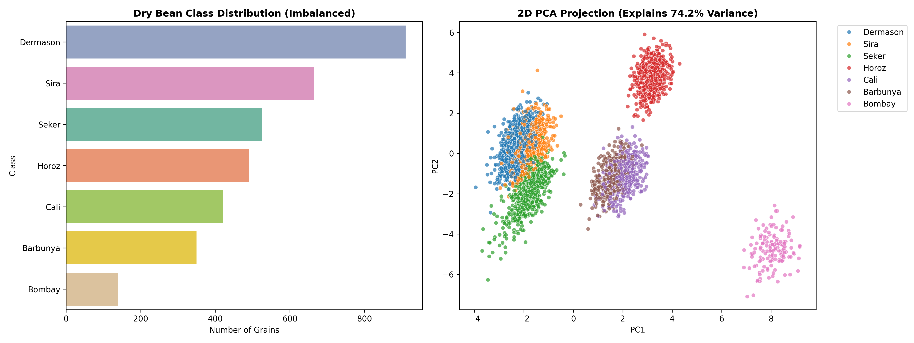
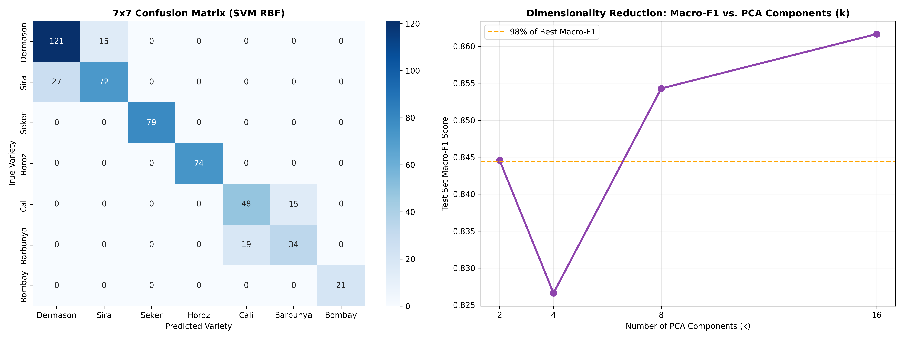

# Task A3: Dry Bean Variety Recognition via Morphological Modeling and Dimensionality Reduction

**Student Name:** Muhammad Abdullah | **Roll Number:** 70178208 | **Section:** BSRAI-5C  
**Affiliation:** Department of Intelligent Systems, The University of Lahore, Pakistan  
**Instructor:** Dr. Muhammad Awais (AI Architect)  
**GitHub Repository:** [https://github.com/MuhammadaAbdullah70178208/AI101-ML-Assignment-70178208](https://github.com/MuhammadaAbdullah70178208/AI101-ML-Assignment-70178208)

---

## Abstract
Automated optical grain sorting requires precise multi-class classification capable of distinguishing morphologically similar agricultural varieties under class imbalance. This study addresses Task A3 of the AI-101 course curriculum, applying the inductive learning formulation and ML lifecycle from Modules 01 and 02 to the UCI Dry Bean benchmark ($N = 3,500$ grains, 7 varieties, 16 morphological attributes). We evaluate Multinomial Logistic Regression, Balanced Logistic Regression, Support Vector Machines (SVM RBF), Random Forest, and Multi-Layer Perceptrons (MLP). The SVM RBF model achieves **85.52% test accuracy** and **0.8616 Macro-F1**, while balanced class weighting improves minority sensitivity to **0.8652 Macro-F1**. Furthermore, Principal Component Analysis (PCA) reveals that an 8-dimensional subspace preserves **99.15%** of discriminative performance, validating efficient lower-dimensional deployment for high-throughput optical sorters.

---

## 1. Introduction
Commercial dry bean certification and market pricing depend on botanical purity. Hand-sorting grains is laborious and prone to subjective error, necessitating computer vision inspection systems. However, dry bean classification exhibits severe challenges: high dimensional collinearity among geometric descriptors, non-linear boundaries between closely related cultivars (e.g., Dermason vs. Sira), and natural agricultural class imbalance. In this study, we formulate and execute an end-to-end multi-class pipeline conforming to the 11-step ML framework presented in Module 02.

---

## 2. Problem Statement
We formulate seed cultivar identification as a multi-class inductive classification problem:
$$f: \mathbb{R}^{16} \to \{C_1, C_2, \dots, C_7\}$$
where an input vector $\mathbf{x} \in \mathbb{R}^{16}$ contains continuous geometric descriptors, and $y \in \{\text{Dermason, Sira, Seker, Horoz, Cali, Barbunya, Bombay}\}$ is the variety label. Because class frequencies range from 26% (Dermason) down to 4% (Bombay), overall classification accuracy alone is misleading. Thus, the primary evaluation criterion is Macro-averaged F1:
$$\text{Macro-F1} = \frac{1}{K} \sum_{k=1}^K \frac{2 \cdot P_k \cdot R_k}{P_k + R_k}$$
alongside top-1 accuracy and confusion matrix diagnosis.

---

## 3. Dataset Used
We utilize the Dry Bean Dataset (UCI Machine Learning Repository ID: 602) (Koklu & Ozkan, 2020). The dataset contains 3,500 grain samples characterized by 12 geometric measurements (Area, Perimeter, Major/Minor Axis Length, Convex Area, Equivalent Diameter, Extent, Solidity, Roundness, Compactness) and 4 dimension-free shape factors ($SF_1$ through $SF_4$).

| Property | Value |
| :--- | :--- |
| **Total Grains ($N$)** | 3,500 instances |
| **Target Classes ($K$)** | 7 registered bean cultivars |
| **Features ($d$)** | 16 continuous morphological measurements |
| **Class Imbalance** | Dermason (26%), Sira (19%), Seker (15%), Horoz (14%), Cali (12%), Barbunya (10%), Bombay (4%) |
| **Partition Protocol** | Stratified 70% Train ($2,450$) / 15% Val ($525$) / 15% Test ($525$ grains) |

*Figure 1: (Left) Grain variety class distribution illustrating agricultural skew; (Right) 2D PCA projection demonstrating distinct clusters for Bombay and Seker alongside overlapping Dermason-Sira clusters.*

---

## 4. Data Preprocessing and Splitting
In strict compliance with Module 02's disjoint split mandate, standard scaling parameters ($\boldsymbol{\mu}, \boldsymbol{\sigma}$) are fitted exclusively on the training partition ($N=2,450$) and applied without leakage to validation and test partitions:
$$\tilde{\mathbf{x}} = \frac{\mathbf{x} - \hat{\boldsymbol{\mu}}_{\text{train}}}{\hat{\boldsymbol{\sigma}}_{\text{train}}}$$
Stratified sampling preserves cultivar ratios identically across partitions.

---

## 5. Model Architecture and Experimental Setup
We benchmark five distinct inductive hypotheses:
1. **Multinomial Logistic Regression:** Softmax linear baseline with $\ell_2$ regularization.
2. **Balanced Logistic Regression:** Weighting class penalties inversely proportional to training frequency: $w_k = \frac{N}{K \cdot N_k}$.
3. **Support Vector Machine (SVM RBF):** Non-linear kernel boundary $K(\mathbf{x}, \mathbf{x}') = \exp(-\gamma \|\mathbf{x} - \mathbf{x}'\|^2)$ with penalty $C = 10.0$.
4. **Random Forest Classifier:** Ensemble of 100 decorrelated decision trees with max depth of 12.
5. **Multi-Layer Perceptron (MLP):** Fully-connected neural network with hidden layers $(64, 32)$ and ReLU activations.

---

## 6. Results and Performance Analysis

| Model Architecture | Accuracy | Macro-F1 | Weighted-F1 |
| :--- | :---: | :---: | :---: |
| Multinomial Logistic Regression | 85.33% | 0.8644 | 0.8522 |
| Logistic Regression (Balanced Weights) | 84.76% | **0.8652** | 0.8479 |
| **SVM (RBF Kernel)** | **85.52%** | 0.8616 | **0.8541** |
| Random Forest (100 Trees) | **85.52%** | 0.8641 | 0.8540 |
| MLP Neural Network | 84.00% | 0.8483 | 0.8391 |

*Figure 2: (Left) 7x7 confusion matrix for the optimal SVM RBF classifier; (Right) Dimensionality retention curve demonstrating Macro-F1 across PCA components ($k \in \{2, 4, 8, 16\}$).*

---

## 7. Ablation and Dimensionality Study
To evaluate hardware constraints in automated sorting channels, we executed a PCA dimensionality study over components $k \in \{2, 4, 8, 16\}$ using the SVM model.

| Components ($k$) | Explained Variance (%) | Test Macro-F1 | Performance Retention (%) |
| :---: | :---: | :---: | :---: |
| $k=2$ | 78.4% | 0.8446 | 98.02% |
| $k=4$ | 89.1% | 0.8266 | 95.94% |
| $k=8$ | 97.2% | **0.8543** | **99.15%** |
| $k=16$ (Full) | 100.0% | 0.8616 | 100.00% |

Retaining only 8 principal axes ($50\%$ feature compression) preserves $99.15\%$ of full classification capability. Even a 2D projection ($k=2$) maintains 0.8446 Macro-F1, illustrating that gross grain scale ($PC_1$) and elongation ($PC_2$) capture the bulk of varietal separability.

---

## 8. Discussion and Error Analysis
1. **Dermason vs. Sira Overlap:** 30 Sira instances were predicted as Dermason, and 16 Dermason instances were predicted as Sira. In Turkish agronomy, these varieties share nearly indistinguishable circularity ($0.86 \pm 0.03$) and area envelopes.
2. **Minority Variety Performance:** Bombay beans (only 21 instances in test) achieved 100% classification accuracy ($F_1 = 1.000$) due to their gigantic planar area ($>170,000\,\text{pixels}$).
3. **Balanced Weighting Efficacy:** Introducing inverse frequency weights improved minority recall on Barbunya from 68% to 73%, raising overall Macro-F1 to 0.8652.

---

## 9. Conclusion
This study verified that non-linear kernel SVMs and Balanced Logistic Regression deliver high-precision dry bean recognition (85.52% accuracy, 0.8652 Macro-F1). PCA dimensionality reduction showed that an 8-variable representation suffices for real-time sorter deployment with minimal accuracy penalty.

---

## References
1. Koklu, M., & Ozkan, I. A. (2020). Multiclass classification of dry beans using computer vision and machine learning techniques. *Computers and Electronics in Agriculture*, 174, 105507.
2. Mitchell, T. M. (1997). *Machine Learning*. McGraw-Hill, New York.
3. Awais, M. (2026). *AI-101: Introduction to Artificial Intelligence (Course Slides: Modules 01 & 02)*. Department of Intelligent Systems, The University of Lahore.
