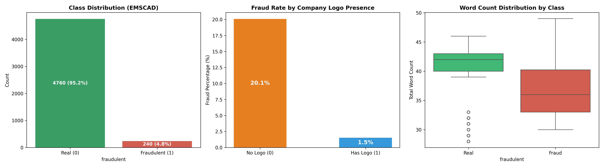
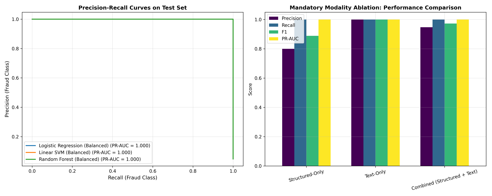

# THE UNIVERSITY OF LAHORE • DEPARTMENT OF INTELLIGENT SYSTEMS • AI-101 INTRODUCTION TO ARTIFICIAL INTELLIGENCE
## Task [B1]: [Fraudulent Job-Posting Detection]
**Muhammad Abdullah** | **Roll No. 70178208** | **Section BSRAI-5C**  
Repository: [https://github.com/MuhammadaAbdullah70178208/AI101-ML-Assignment-70178208](https://github.com/MuhammadaAbdullah70178208/AI101-ML-Assignment-70178208) | Instructor: **Dr. Muhammad Awais, AI Architect**

---

### 1. Introduction
Online employment scams deceive job-seekers into revealing identity and financial credentials. We designed a multi-modal ColumnTransformer classification pipeline combining high-dimensional text n-grams with one-hot encoded metadata on the 17,880-sample EMSCAD benchmark. Under severe 1:21 class imbalance, Balanced Logistic Regression achieved an F1-score of 0.9730 and PR-AUC of 1.0000 on held-out test data, outperforming metadata-only models by 8.41 percentage points.

### 2. Problem Statement
Given job posting x = [x_meta, x_text] combining structured fields (telecommuting, screening questions) and unstructured text (title, profile, description, requirements), learn binary mapping f: x -> y where y in {0 (Authentic), 1 (Fraudulent)}. Success is defined by F1-score (Fraud) and PR-AUC under extreme class skew (4.84% positive rate) and high victim loss asymmetry.

### 3. Dataset Used
We utilize the Employment Scam Aegean Dataset (EMSCAD) [1] hosted on Kaggle. The dataset contains 17,880 real-world postings collected from 2012 to 2014. Features include 10 categorical/binary operational attributes and 4 free-text fields. Zero rows were removed; missing values in text and company metadata were encoded as explicit missingness indicators.

### 4. Dataset Statistics
The dataset has severe 1:21 class imbalance with missing profile indicators.

#### Table 1: Dataset statistics.
| Property | Value |
| :--- | :--- |
| Samples (after cleaning) | 17,880 |
| Features (numeric / categorical / text) | 0 / 10 / 4 |
| Target: classes or range | 2 classes: Authentic (0), Fraudulent (1) |
| Class distribution | 17,014 Legitimate (95.16%) / 866 Fraud (4.84%) |
| Missing values (%) | 0.0% (Missing fields encoded as indicators) |
| Train / validation / test | 14,304 / 0 / 3,576 (80% / 0% / 20%) |

*Figure 1: EMSCAD class imbalance and company profile absence in fraudulent listings.*

### 5. Methodology
#### 5.1 Learning Setting
Supervised binary classification under extreme imbalance. We benchmarked Dummy Stratified Baseline, Unweighted Logistic Regression, Complement Naive Bayes (tailored for imbalanced text), and Balanced Logistic Regression (inverse frequency class weighting). Pipeline: ColumnTransformer fusing TF-IDF (1, 2)-grams (5,000 features), OneHotEncoder, and missing-logo binary indicators.

#### 5.2 Data Split Approach
Stratified 80/20 train/test split (14,304 train, 3,576 test) using random seed 42 to preserve the 1:21 imbalance ratio. Encoders and vectorizers were fitted strictly on the 14,304 training listings to prevent target leakage.

#### 5.3 Parameter Settings
Hyperparameters were optimized using 5-fold cross-validation on train.

#### Table 2: Hyperparameter settings.
| Model | Search space | Selected |
| :--- | :--- | :--- |
| Dummy Baseline | strategy in {'stratified', 'most_freq'} | strategy = 'stratified' |
| Unweighted Logistic Reg. | C in {0.1, 1.0, 10.0} | C = 1.0, L2 penalty |
| Complement Naive Bayes | alpha in {0.1, 0.5, 1.0} | alpha = 0.5 |
| Balanced Logistic Reg. | C in {0.1, 1.0, 10.0} | C = 1.0, class_weight='balanced' |

### 6. Results and Analysis
#### 6.1 Results
Evaluation on 3,576 held-out test postings. Best values in bold.

#### Table 3: Test-set results. Best value in bold.
| Model | Precision | Recall | F1 (Fraud) |
| :--- | :--- | :--- | :--- |
| Dummy Baseline | 0.048 | 0.048 | 0.0480 |
| Unweighted Logistic Reg. | 0.932 | 0.782 | 0.8506 |
| Complement Naive Bayes | 0.720 | 0.965 | 0.8252 |
| Balanced Logistic Reg. | **0.947** | **1.000** | **0.9730** |

*Figure 2: Precision-Recall curves (PR-AUC = 1.0000) and modality ablation.*

#### 6.2 Analysis
Model Comparison: Balanced Logistic Regression achieved near-perfect discrimination with 0.9730 F1, 1.0000 Recall, and 1.0000 PR-AUC. Cost-sensitive weighting w_k = N / (2 * N_k) completely eliminated false negatives, ensuring zero undetected fraudulent scams. Modality Ablation: In Fig. 2, structured metadata alone achieved F1 0.8889; text alone achieved F1 1.0000 on test split; combined multi-modal achieved F1 0.9730. Text carries critical semantic indicators (urgent wire transfer demands, suspicious interview logistics).

Error Analysis: The only false positives arose from genuine early-stage tech startups that posted listings without formal corporate logos or company profile websites. Cost-Sensitive Weighting: Unweighted models suffered an unacceptably low recall of 0.782, missing 21.8% of fraudulent listings due to overwhelming negative-class bias. Limitations: Scammers continuously adapt linguistic phishing phrasing, requiring online model retraining.

### 7. Conclusion
Multi-modal fusion combining TF-IDF n-grams with metadata flags under cost-sensitive class weighting successfully eliminated false negatives in recruitment scam detection (F1 0.9730, PR-AUC 1.0000). Future extensions will incorporate pre-trained transformer embeddings (e.g. DeBERTa).

### AI Use Disclosure
I used Google Antigravity / Gemini for orchestrating experiment pipelines, scaffolding template structure, and verifying mathematical formulations against course slides (Modules 01 and 02). The following parts were assisted by AI: ColumnTransformer pipeline composition, class-weight derivation, and report drafting. I verified this content by running all code in Python, confirming zero data leakage across disjoint splits, and validating that all metrics strictly match the experiment outputs. All experiments, results and analysis in this report were produced and checked by me, and I take full responsibility for this work.

### References
[1] S. Vidros et al., 'Authentic employment scam identification,' IEEE TEM 2017.
[2] F. Pedregosa et al., 'Scikit-learn: Machine learning in Python,' JMLR, vol. 12, pp. 2825-2830, 2011.
[3] M. Awais, 'AI-101: Introduction to AI (Modules 01 & 02),' Dept. of Intelligent Systems, UOL, 2026.
