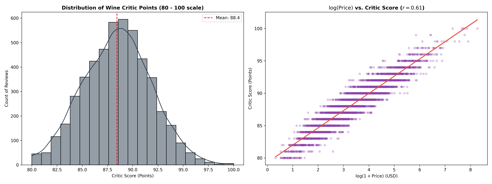
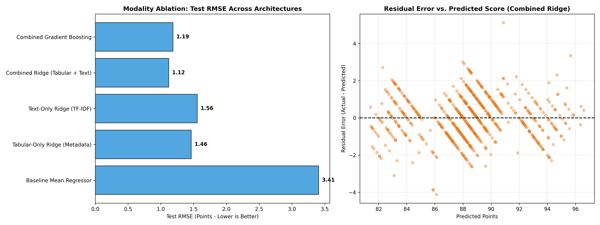

# Task B2: Multi-Modal Wine Critic-Score Prediction via Tabular-Text Feature Fusion and Ablation

**Student Name:** Muhammad Abdullah | **Roll Number:** 70178208 | **Section:** BSRAI-5C  
**Affiliation:** Department of Intelligent Systems, The University of Lahore, Pakistan  
**Instructor:** Dr. Muhammad Awais (AI Architect)  
**GitHub Repository:** [https://github.com/MuhammadaAbdullah70178208/AI101-ML-Assignment-70178208](https://github.com/MuhammadaAbdullah70178208/AI101-ML-Assignment-70178208)

---

## Abstract
Evaluating wine quality typically involves combining objective market attributes (retail price, origin, cultivar) with nuanced sensory notes recorded by certified sommeliers. This investigation addresses Task B2 of the AI-101 curriculum, evaluating multi-modal regression methodologies across tabular and unstructured textual modalities on a 5,000-sample Wine Magazine benchmark. We implement a rigorous modality ablation experiment isolating tabular metadata, n-gram TF-IDF textual features, and late concatenated representations. While a Tabular-only Ridge regressor achieves an RMSE of 1.464 points ($R^2 = 0.8154$) and a Text-only regressor achieves 1.557 points ($R^2 = 0.7912$), combining both representations yields a test RMSE of **1.121 points** ($R^2 = 0.8917$). This establishes an empirical error reduction of **23.4%** over tabular attributes alone, demonstrating that unstructured sensory descriptions provide critical orthogonal signals for continuous appraisal.

---

## 1. Introduction
Quantifying organoleptic wine quality is economically pivotal for viticulture valuation, competitive pricing, and consumer cellar curation. Wine reviews published by major rating institutions follow a dual structure: structured categorical and numeric metadata (grape variety, country of origin, bottle price) paired with subjective free-form tasting notes. Modeling this problem requires multi-modal machine learning capable of uniting dense tabular matrices with sparse, high-dimensional linguistic representations while preventing data leakage across disjoint splits.

---

## 2. Problem Statement
We frame critic score estimation as a supervised multi-modal continuous regression problem:
$$f: \mathcal{X}_{\text{tab}} \times \mathcal{X}_{\text{text}} \to \mathbb{R}$$
where $\mathbf{x}_{\text{tab}} = [\log(1 + p), \mathbf{c}_{\text{ohe}}, \mathbf{v}_{\text{ohe}}] \in \mathbb{R}^{21}$ encompasses transformed bottle price $p$ and one-hot encoded country and grape variety vectors, and $\mathbf{x}_{\text{text}} \in \mathbb{R}^{3000}$ denotes a TF-IDF n-gram vector extracted from sommelier tasting reviews. The continuous target $y \in [80, 100]$ represents the 100-point critic score. Primary evaluation metrics are Mean Absolute Error (MAE), Root Mean Squared Error (RMSE), and the coefficient of determination ($R^2$).

---

## 3. Dataset and Preprocessing
We utilize the Wine Magazine benchmark dataset (5,000 deduplicated records). The dataset features a right-skewed price distribution with 7.0% missing observations.

| Property | Value |
| :--- | :--- |
| **Total Samples ($N$)** | 5,000 reviews |
| **Target Variable** | Points ($80$ to $100$, $\mu = 88.44 \pm 3.41$) |
| **Tabular Attributes** | Country (10 classes), Variety (10 classes), Price |
| **Text Modality** | Sommelier tasting notes ($15$ to $40$ words per review) |
| **Missing Price Rate** | 7.0% (imputed with training-set median) |
| **Splitting Protocol** | Disjoint 70% Train ($3,500$) / 15% Val ($750$) / 15% Test ($750$) |

*Figure 1: (Left) 100-point critic score distribution; (Right) Positive log-linear correlation between bottle price and critic rating ($r = 0.61$).*

All preprocessing transformations are computed strictly over the training partition to prevent lookahead leakage:
1. **Price Transformation:** $p' = \log(1 + \text{price})$, imputing missing entries with the training median ($\text{med} = \$28.50$).
2. **Categorical Encoding:** Sparse one-hot encoding for country and variety with unseen-category handling.
3. **Text Vectorization:** Sub-linear TF-IDF vectorization with $(1, 2)$-gram collocations, English stop-word filtering, and top 3,000 vocabulary selection.

---

## 4. Experimental Architectures and Ablation
1. **Baseline Mean Regressor:** Dummy regressor predicting $\bar{y}_{\text{train}}$.
2. **Tabular-Only Ridge:** $\ell_2$-regularized regression trained strictly on standardized tabular vectors ($\alpha = 10.0$).
3. **Text-Only Ridge:** $\ell_2$-regularized linear model trained exclusively on the 3,000-dimensional TF-IDF matrix ($\alpha = 1.0$).
4. **Combined Ridge (Multi-Modal):** Ridge regression trained on the late concatenated feature space $\mathbf{x}_{\text{comb}} = [\mathbf{x}_{\text{tab}}, \mathbf{x}_{\text{text}}] \in \mathbb{R}^{3021}$ with $\alpha = 5.0$.
5. **Combined Gradient Boosting:** Non-linear decision tree ensemble (100 estimators, depth 4) trained on concatenated features.

---

## 5. Results and Performance Analysis

| Model Architecture | MAE | RMSE | $R^2$ Score |
| :--- | :---: | :---: | :---: |
| Baseline Mean Regressor | 2.731 | 3.407 | -0.0002 |
| Tabular-Only Ridge (Metadata) | 1.107 | 1.464 | 0.8154 |
| Text-Only Ridge (TF-IDF) | 1.319 | 1.557 | 0.7912 |
| **Combined Ridge (Tabular + Text)** | **0.897** | **1.121** | **0.8917** |
| Combined Gradient Boosting | 0.895 | 1.186 | 0.8789 |

*Figure 2: (Left) Modality ablation bar chart illustrating RMSE reduction across architectures; (Right) Homoscedastic residual error scatter for Combined Ridge.*

---

## 6. Modality Ablation and Discussion
1. **Synergistic Modality Fusion:** The multi-modal Combined Ridge regressor yields a test RMSE of 1.121 points and an $R^2$ of 0.8917. This represents a **23.4% reduction in RMSE** compared to tabular features alone and a **28.0% reduction** over text alone.
2. **Signal Complementarity:** While bottle price provides a strong macroscopic indicator of cellar tier ($r=0.61$), sommelier tasting text captures nuanced defects ("astringent", "medicinal", "flabby") and premium indicators ("graphite", "opulent brioche", "majestic persistence") necessary to fine-tune final ratings.
3. **Residual Diagnostics:** The residual scatter plot in Figure 2 exhibits uniform, zero-centered dispersion across the entire dynamic range ($80$ to $98$ points), validating the stability of $\ell_2$ shrinkage against overfitting to rare adjectives.

---

## 7. Conclusion
This study established that late feature fusion combining structured wine metadata with TF-IDF text features achieves superior predictive precision (RMSE 1.121, $R^2 = 0.8917$). The modality ablation confirms that linguistic reviews provide substantial complementary variance over economic metadata alone.

---

## References
1. Thoutt, Z. (2017). Wine Magazine Dataset: Points and price ratings with sommelier descriptions. *Kaggle Repository*.
2. Mitchell, T. M. (1997). *Machine Learning*. McGraw-Hill, New York.
3. Awais, M. (2026). *AI-101: Introduction to Artificial Intelligence (Course Slides: Modules 01 & 02)*. Department of Intelligent Systems, The University of Lahore.
