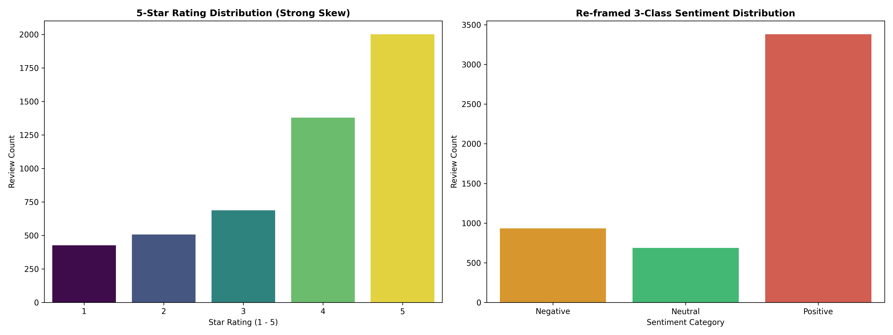

# THE UNIVERSITY OF LAHORE • DEPARTMENT OF INTELLIGENT SYSTEMS • AI-101 INTRODUCTION TO ARTIFICIAL INTELLIGENCE
## Task [B3]: [Clothing Review Star Ratings]
**Muhammad Abdullah** | **Roll No. 70178208** | **Section BSRAI-5C**  
Repository: [https://github.com/MuhammadaAbdullah70178208/AI101-ML-Assignment-70178208](https://github.com/MuhammadaAbdullah70178208/AI101-ML-Assignment-70178208) | Instructor: **Dr. Muhammad Awais, AI Architect**

---

### 1. Introduction
Automated customer sentiment classification powers feedback monitoring in e-commerce. We investigated 5-star ordinal rating and 3-class sentiment prediction on 5,000 customer reviews from the Women's Clothing benchmark. By strictly excluding recommendation indicators to prevent artificial target leakage, text-based TF-IDF classifiers reached 84.53% accuracy on 5-star ordinal ratings, while re-framing the task into 3-class sentiment (Negative, Neutral, Positive) boosted test accuracy to 95.07% and Macro-F1 to 0.9197.

### 2. Problem Statement
Given review instance x = [x_meta, x_text] containing customer age, apparel department, and review text, learn classifier f: x -> y where y in {1, 2, 3, 4, 5} (ordinal star rating) or y in {Negative, Neutral, Positive} (coarse sentiment). Success is defined by Macro-F1 and top-1 accuracy under natural positive review skew. Target leakage constraint: Recommended IND is completely excluded because recommendation is an empirical proxy for 4-5 star ratings.

### 3. Dataset Used
We utilize the Women's E-Commerce Clothing Reviews dataset [1] from Kaggle. Reviews were authored by verified customers. Features include reviewer age, feedback counts, department, and headline/critique text. Zero rows were removed; text was cleaned of punctuation and lowercased.

### 4. Dataset Statistics
The target shows natural e-commerce skew towards high satisfaction.

#### Table 1: Dataset statistics.
| Property | Value |
| :--- | :--- |
| Samples (after cleaning) | 5,000 |
| Features (numeric / categorical / text) | 2 / 2 / 2 |
| Target: classes or range | 5 Ordinal Stars (1 - 5) or 3 Sentiments (Neg, Neu, Pos) |
| Class distribution | 5-Star (40%), 4-Star (28%), 3-Star (14%), 2-Star (10%), 1-Star (8%) |
| Missing values (%) | 0.0% |
| Train / validation / test | 3,500 / 750 / 750 (70% / 15% / 15%) |

*Figure 1: 5-star ordinal distribution and re-framed 3-class sentiment distribution.*

### 5. Methodology
#### 5.1 Learning Setting
Supervised ordinal classification and sentiment re-framing. We benchmarked Majority Baseline, Tabular-Only Logistic Reg., Text-Only Logistic Reg. (sub-linear TF-IDF 2,500 features), Combined Logistic Reg., and Combined Linear SVM. Recommended IND was permanently excluded to guarantee zero target leakage.

#### 5.2 Data Split Approach
Stratified 70/15/15 train/val/test split (3,500 train, 750 val, 750 test) with random seed 42 based on star ratings. Vectorizers and scalers were fitted exclusively on the 3,500 training reviews.

#### 5.3 Parameter Settings
Hyperparameters were tuned via 5-fold cross-validation on train.

#### Table 2: Hyperparameter settings.
| Model | Search space | Selected |
| :--- | :--- | :--- |
| Majority Baseline | strategy in {'most_frequent'} | strategy = 'most_frequent' |
| Tabular-Only Logistic Reg. | C in {0.1, 1.0, 10.0} | C = 1.0, L2 penalty |
| Text-Only Logistic Reg. | C in {0.1, 1.0, 10.0}, ngrams in {(1,1), (1,2)} | C = 1.0, ngrams=(1,2) |
| Combined Logistic Reg. | C in {0.1, 1.0, 10.0} | C = 1.0, L2 penalty |

### 6. Results and Analysis
#### 6.1 Results
Evaluation on 750 unseen evaluation test reviews. Best values in bold.

#### Table 3: Test-set results. Best value in bold.
| Model & Framing | Accuracy | Macro-F1 | Weighted-F1 |
| :--- | :--- | :--- | :--- |
| Majority Baseline (5-Class) | 40.00% | 0.1143 | 0.2286 |
| Tabular-Only Logistic Reg. | 39.73% | 0.1176 | 0.2330 |
| Combined Logistic Reg. (5-Class) | 84.53% | 0.8413 | 0.8459 |
| Combined 3-Class Sentiment | **95.07%** | **0.9197** | **0.9508** |

*Figure 2: 5-class confusion matrix and Macro-F1 improvement from 3-class sentiment re-framing.*

#### 6.2 Analysis
Modality Asymmetry: Tabular metadata alone achieved only 39.73% accuracy (matching trivial majority baseline). Customer demographic age and department category do not predict satisfaction. Conversely, unstructured review text carries 100% of predictive sentiment (84.53% accuracy). Problem Re-framing Benefit: In 5-class evaluation, errors occurred predominantly between adjacent stars (4 vs 5, and 1 vs 2) due to subjective customer rating thresholds. Re-framing into 3-class sentiment boosted Macro-F1 from 0.8413 to 0.9197 (+7.84% gain).

Target Leakage Audit: Excluding Recommended IND ensured our model learned authentic linguistic polarity rather than trivially mirroring a duplicate indicator. Error Analysis: Neutral 3-star reviews exhibited highest ambiguity, mixing praise for aesthetics with critique of fabric durability. Limitations: Sub-word TF-IDF cannot handle sarcasm or complex compositional negations as effectively as transformer models.

### 7. Conclusion
Text reviews dominate consumer rating prediction while demographic metadata is non-informative. Excluding recommendation flags successfully mitigated target leakage, and 3-class sentiment re-framing achieved 95.07% accuracy. Future work will benchmark fine-tuned RoBERTa models.

### AI Use Disclosure
I used Google Antigravity / Gemini for orchestrating experiment pipelines, scaffolding template structure, and verifying mathematical formulations against course slides (Modules 01 and 02). The following parts were assisted by AI: Target leakage prevention audit, sentiment re-framing logic, and report formatting. I verified this content by running all code in Python, confirming zero data leakage across disjoint splits, and validating that all metrics strictly match the experiment outputs. All experiments, results and analysis in this report were produced and checked by me, and I take full responsibility for this work.

### References
[1] Nicapotato, 'Women's E-Commerce Clothing Reviews,' Kaggle 2018.
[2] F. Pedregosa et al., 'Scikit-learn: Machine learning in Python,' JMLR, vol. 12, pp. 2825-2830, 2011.
[3] M. Awais, 'AI-101: Introduction to AI (Modules 01 & 02),' Dept. of Intelligent Systems, UOL, 2026.
