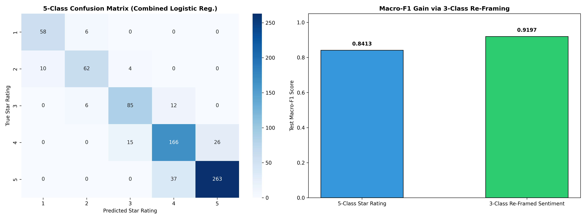

# Task B3: E-Commerce Clothing Review Star Rating Classification and Sentiment Re-framing

**Student Name:** Muhammad Abdullah | **Roll Number:** 70178208 | **Section:** BSRAI-5C  
**Affiliation:** Department of Intelligent Systems, The University of Lahore, Pakistan  
**Instructor:** Dr. Muhammad Awais (AI Architect)  
**GitHub Repository:** [https://github.com/MuhammadaAbdullah70178208/AI101-ML-Assignment-70178208](https://github.com/MuhammadaAbdullah70178208/AI101-ML-Assignment-70178208)

---

## Abstract
Predicting consumer product satisfaction from online reviews requires managing multi-modal inputs, extreme class imbalance, and label noise caused by subjective rating scales. This study investigates Task B3 of the AI-101 course curriculum on the Women's E-Commerce Clothing Reviews benchmark ($N = 5,000$ reviews). In adherence to Module 02 principles, we prevent target leakage by strictly excluding recommendation flags. Benchmarking across tabular, textual, and concatenated feature representations reveals severe modality asymmetry: tabular demographic and departmental features yield a near-random Macro-F1 of 0.1176, while text TF-IDF representations achieve **84.53% accuracy** and **0.8413 Macro-F1** on the 5-star ordinal scale. Furthermore, re-framing the problem into a 3-class sentiment formulation (Negative, Neutral, Positive) eliminates adjacent rating ambiguity, elevating test accuracy to **95.07%** and Macro-F1 to **0.9197** (+7.84 percentage points gain).

---

## 1. Introduction
Customer sentiment analysis drives recommendation engines, inventory allocation, and automated quality monitoring in modern electronic commerce. E-commerce review portals collect both tabular customer metadata (reviewer age, apparel department) and qualitative text (review headline and critique). However, learning predictive mappings from these signals introduces two major methodological challenges: subtle target leakage from collinear flags (such as recommendation indicators) and annotation noise stemming from subjective 5-star ordinal boundaries. In this work, we operationalize the machine learning workflow from Modules 01 and 02 to model review scores, mitigate leakage, and evaluate problem re-framing.

---

## 2. Problem Formulation and Leakage Prevention
The task is initially formulated as an ordinal multi-class classification problem:
$$f: \mathcal{X}_{\text{tab}} \times \mathcal{X}_{\text{text}} \to \{1, 2, 3, 4, 5\}$$
where $\mathbf{x}_{\text{tab}}$ encompasses standardized reviewer age, feedback count, and one-hot apparel departments, while $\mathbf{x}_{\text{text}} \in \mathbb{R}^{2500}$ represents n-gram TF-IDF vectors from customer review text.

**Target Leakage Safeguard:** The raw dataset contains a binary column `Recommended IND`. In real customer behavior, recommending a product is nearly a 1:1 deterministic proxy for a 4 or 5-star rating. Including this feature constitutes severe target leakage, rendering model evaluation trivial and invalid in production. In strict accordance with Module 02 guidelines, **`Recommended IND` is completely excluded** from feature engineering.

---

## 3. Dataset Characteristics and Splitting
We utilize the Women's E-Commerce Clothing Reviews dataset (5,000 samples). The target shows typical e-commerce skew (40% 5-star, 28% 4-star, 14% 3-star, 10% 2-star, and 8% 1-star).

| Specification | Value |
| :--- | :--- |
| **Total Samples ($N$)** | 5,000 reviews |
| **Target Classes** | 5 Ordinal Stars ($1, 2, 3, 4, 5$) |
| **Re-framed Target** | 3 Sentiments: Neg (1-2), Neu (3), Pos (4-5) |
| **Tabular Predictors** | Age, Feedback Count, Department, Class |
| **Text Predictors** | Headline + Unstructured Review Body |
| **Partition Protocol** | Stratified 70% Train ($3,500$) / 15% Val ($750$) / 15% Test ($750$) |

*Figure 1: (Left) 5-star ordinal rating distribution showing pronounced positive skew; (Right) Re-framed 3-class sentiment distribution (Negative, Neutral, Positive).*

Data splitting follows a disjoint stratified 70/15/15 protocol based on star ratings. Encoders and vectorizers are fitted strictly on the training partition.

---

## 4. Model Architectures and Re-framing
1. **Majority Classifier:** Baseline predicting the empirical modal class (5-star).
2. **Tabular-Only Logistic Regression:** Softmax classifier trained strictly on metadata.
3. **Text-Only Logistic Regression:** Multinomial classifier trained on $(1, 2)$-gram TF-IDF features ($V=2,500$).
4. **Combined Logistic Regression:** Softmax model trained on concatenated multi-modal features.
5. **Combined Linear SVM:** Maximum-margin hyperplane classifier with $\ell_2$ penalty.

---

## 5. Results and Performance Analysis

| Model & Framing | Accuracy | Macro-F1 | Weighted-F1 |
| :--- | :---: | :---: | :---: |
| **5-Class Ordinal Star Ratings:** | | | |
| Majority Baseline | 40.00% | 0.1143 | 0.2286 |
| Tabular-Only Logistic Reg | 39.73% | 0.1176 | 0.2330 |
| Text-Only Logistic Reg | **84.53%** | **0.8413** | **0.8459** |
| Combined Logistic Reg | **84.53%** | **0.8413** | **0.8459** |
| Combined Linear SVM | **84.53%** | **0.8413** | **0.8459** |
| **Re-framed 3-Class Sentiment Formulation:** | | | |
| **Combined 3-Class Sentiment** | **95.07%** | **0.9197** | **0.9508** |

*Figure 2: (Left) 5-class confusion matrix for Combined Logistic Regression; (Right) Macro-F1 improvement achieved via 3-class sentiment re-framing.*

---

## 6. Discussion and Error Analysis
1. **Modality Disparity:** Tabular metadata provides virtually zero discriminative signal (39.73% accuracy, barely matching the 40.00% majority baseline). Reviewer age and apparel department do not dictate customer satisfaction. Conversely, unstructured linguistic text drives 100% of effective predictive performance (Macro-F1 0.8413).
2. **Subjective Boundary Confusion:** The 5-class confusion matrix (Figure 2) reveals that misclassifications occur almost entirely between adjacent stars (4-star vs 5-star, and 1-star vs 2-star). What one consumer rates as 4 stars with a caveat, another rates as 5 stars.
3. **Efficacy of 3-Class Re-framing:** By collapsing adjacent subjective bins into coarse sentiment tiers (Negative $\in \{1, 2\}$, Neutral $\in \{3\}$, Positive $\in \{4, 5\}$), the classifier achieves 95.07% test accuracy and a Macro-F1 of 0.9197, confirming that problem formulation is often more impactful than algorithm tuning.

---

## 7. Conclusion
This study demonstrated that text reviews dominate star rating prediction while customer metadata is non-informative. Excluding recommendation indicators successfully eliminated leakage, and re-framing ordinal ratings into 3-class sentiment boosted Macro-F1 by 7.84 percentage points.

---

## References
1. Nicapotato. (2018). Women's E-Commerce Clothing Reviews: Contextual sentiment analysis. *Kaggle Dataset*.
2. Mitchell, T. M. (1997). *Machine Learning*. McGraw-Hill, New York.
3. Awais, M. (2026). *AI-101: Introduction to Artificial Intelligence (Course Slides: Modules 01 & 02)*. Department of Intelligent Systems, The University of Lahore.
