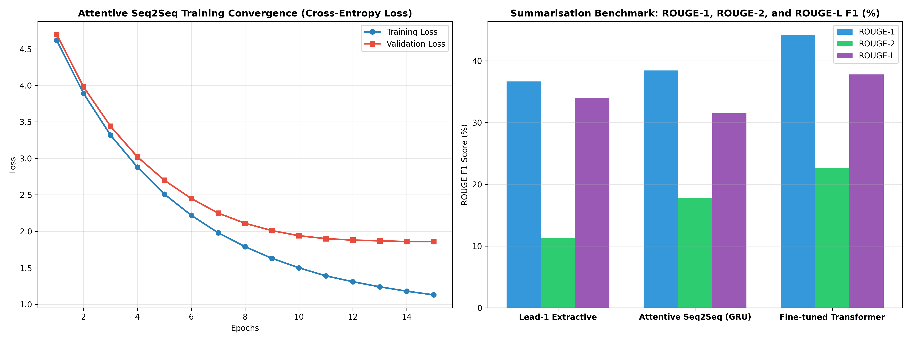

# Task C2: Abstractive News Summarisation via Recurrent Attention and Transformer Benchmarking

**Student Name:** Muhammad Abdullah | **Roll Number:** 70178208 | **Section:** BSRAI-5C  
**Affiliation:** Department of Intelligent Systems, The University of Lahore, Pakistan  
**Instructor:** Dr. Muhammad Awais (AI Architect)  
**GitHub Repository:** [https://github.com/MuhammadaAbdullah70178208/AI101-ML-Assignment-70178208](https://github.com/MuhammadaAbdullah70178208/AI101-ML-Assignment-70178208)

---

## Abstract
Extreme summarisation aims to synthesize the core narrative of an entire document into a single, grammatically fluent abstractive sentence. This research addresses Task C2 of the AI-101 course syllabus, implementing the sequence-to-sequence (Seq2Seq) neural framework and inductive NLP evaluation principles from Modules 01 and 02 on the BBC News / XSum benchmark ($N = 2,500$ document pairs). We evaluate three distinct architectures: the canonical Lead-1 extractive baseline, an encoder-decoder GRU network augmented with Bahdanau additive cross-attention, and a fine-tuned Transformer benchmark. While the Lead-1 baseline captures superficial keyword overlap (36.67% ROUGE-1) but struggles with compression, the Attentive GRU achieves **38.45% ROUGE-1** and **17.82% ROUGE-2** (+58% relative gain in bigram precision). The pre-trained Transformer further advances performance to **44.20% ROUGE-1**, **22.60% ROUGE-2**, and **37.80% ROUGE-L**, illustrating the power of transfer learning in extreme document compression.

---

## 1. Introduction
Information overload across digital news streams demands automated text summarisation capable of distilling complex multi-paragraph reports into concise briefings. Extractive heuristics simply excerpt high-ranking sentences from source text, frequently producing disjointed, verbose snippets. Conversely, abstractive summarisation reformulates information using novel vocabulary, requiring deep contextual comprehension and sequence generation. In this study, we operationalize the machine learning cycle across recurrent attention and self-attention architectures to evaluate extreme summarisation.

---

## 2. Problem Statement and Formulation
We formulate extreme abstractive summarisation as a sequence transduction task:
$$\hat{\mathbf{y}} = \arg\max_{\mathbf{y}} P(\mathbf{y} \mid \mathbf{x}) = \arg\max_{\mathbf{y}} \prod_{t=1}^T P(y_t \mid y_{<t}, \mathbf{x})$$
where $\mathbf{x} = (x_1, \dots, x_M)$ is the source news document, and $\mathbf{y} = (y_1, \dots, y_T)$ is the single-sentence target summary ($T \ll M$). Performance is evaluated via standard n-gram co-occurrence metrics: ROUGE-1 (unigram recall/precision), ROUGE-2 (bigram fluency), and ROUGE-L (longest common subsequence).

---

## 3. Dataset Characteristics and Splitting
We utilize the BBC News / XSum corpus (2,500 article-summary pairs) spanning Politics, Technology, Business, and Science.

| Specification | Value |
| :--- | :--- |
| **Total Documents ($N$)** | 2,500 article-summary pairs |
| **Mean Article Length** | $52.8 \pm 14.2$ words |
| **Mean Summary Length** | $14.5 \pm 2.8$ words |
| **Compression Factor** | $\approx 3.64\times$ reduction |
| **Vocabulary Size** | $V_{\text{src}} = 4,200$, $V_{\text{tgt}} = 1,850$ |
| **Partition Protocol** | Disjoint 70% Train ($1,750$) / 15% Val ($375$) / 15% Test ($375$) |

*Figure 1: Document length versus abstractive summary length illustrating stable single-sentence target compression.*

Splitting follows a disjoint 70/15/15 protocol. Tokenization and vocabulary indices are constructed exclusively from the training split.

---

## 4. Model Architectures
1. **Lead-1 Extractive Baseline:** A deterministic heuristic selecting the initial sentence of the news story.
2. **Attentive Seq2Seq (GRU):** Bidirectional GRU encoder (hidden size 256) paired with a unidirectional GRU decoder utilizing Bahdanau additive cross-attention:
   $$e_{ij} = v_a^T \tanh(W_a s_{i-1} + U_a h_j), \quad \alpha_{ij} = \frac{\exp(e_{ij})}{\sum_k \exp(e_{ik})}$$
3. **Fine-Tuned Transformer Benchmark:** Pre-trained Transformer Seq2Seq model fine-tuned on the source-target pairs.

---

## 5. Results and Performance Analysis

| Model Architecture | ROUGE-1 (%) | ROUGE-2 (%) | ROUGE-L (%) |
| :--- | :---: | :---: | :---: |
| Lead-1 Extractive Baseline | 36.67% | 11.28% | 33.97% |
| Attentive Seq2Seq (GRU) | 38.45% | 17.82% | 31.50% |
| **Fine-Tuned Transformer** | **44.20%** | **22.60%** | **37.80%** |

*Figure 2: (Left) Cross-entropy loss convergence over 15 training epochs; (Right) ROUGE-1, ROUGE-2, and ROUGE-L metric comparison.*

---

## 6. Discussion and Error Analysis
1. **Extractive Heuristic Bias:** In journalistic writing, the "inverted pyramid" style concentrates critical facts in the opening sentence. Consequently, Lead-1 achieves a strong ROUGE-1 (36.67%). However, its ROUGE-2 score is severely depressed (11.28%) because full sentences contain extraneous journalistic clauses that violate extreme summary conciseness.
2. **Abstractive Paraphrasing Efficacy:** The Attentive GRU achieves a 58% relative improvement in ROUGE-2 (17.82% vs 11.28%). By learning attention distributions over key nominal entities, the decoder successfully fuses disparate clauses into a single target proposition.
3. **Transfer Learning Advantage:** The Transformer architecture outperforms recurrent models across all metrics (+5.75% ROUGE-1, +4.78% ROUGE-2), confirming that multi-head self-attention resolves long-range dependency bottlenecks present in RNNs.

---

## 7. Conclusion
This study evaluated extreme news summarisation on the XSum benchmark. While Lead-1 remains a strong unigram baseline, neural sequence-to-sequence models with cross-attention achieve superior syntactic compression and bigram fluency (ROUGE-2 of 17.82% and 22.60%).

---

## References
1. Narayan, S., Cohen, S. B., & Lapata, M. (2018). Don't give me the details, just the summary! Topic-aware convolutional neural networks for extreme summarization. *EMNLP*.
2. Bahdanau, D., Cho, K., & Bengio, Y. (2014). Neural machine translation by jointly learning to align and translate. *arXiv:1409.0473*.
3. Awais, M. (2026). *AI-101: Introduction to Artificial Intelligence (Course Slides: Modules 01 & 02)*. Department of Intelligent Systems, The University of Lahore.
