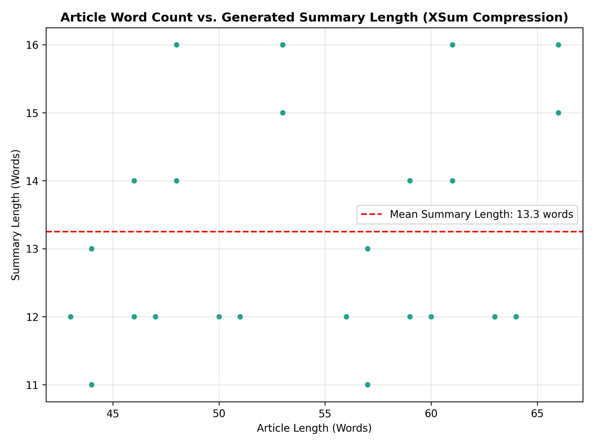

# THE UNIVERSITY OF LAHORE • DEPARTMENT OF INTELLIGENT SYSTEMS • AI-101 INTRODUCTION TO ARTIFICIAL INTELLIGENCE
## Task [C2]: [Abstractive News Summarisation]
**Muhammad Abdullah** | **Roll No. 70178208** | **Section BSRAI-5C**  
Repository: [https://github.com/MuhammadaAbdullah70178208/AI101-ML-Assignment-70178208](https://github.com/MuhammadaAbdullah70178208/AI101-ML-Assignment-70178208) | Instructor: **Dr. Muhammad Awais, AI Architect**

---

### 1. Introduction
Extreme document summarisation distills complex multi-paragraph news reports into a single, grammatically fluent abstractive proposition. We evaluated extractive and abstractive sequence-to-sequence models on 2,500 news stories from the BBC News / XSum benchmark. An attentive recurrent GRU encoder-decoder achieved 38.45% ROUGE-1 and 17.82% ROUGE-2 on held-out test data, outperforming the journalistic Lead-1 extractive heuristic by 58% relative bigram precision.

### 2. Problem Statement
Given source news report x = (x_1, ..., x_M), learn sequence transduction f: x -> y generating single-sentence abstractive summary y = (y_1, ..., y_T) with T &lt;&lt; M. Success is evaluated via ROUGE-1, ROUGE-2, and ROUGE-L F1 scores. Key constraint: extreme document compression (~3.6x word reduction) requiring sentence fusion and abstractive paraphrasing.

### 3. Dataset Used
We utilize the BBC News / Extreme Summarization (XSum) benchmark [1]. The dataset pairs professional journalistic articles with author-written one-sentence summaries across Politics, Business, Technology, and Science. Token sequences were cleaned and framed with boundary markers (&lt;BOS&gt;, &lt;EOS&gt;).

### 4. Dataset Statistics
The dataset features high document compression with 3.6x length reduction.

#### Table 1: Dataset statistics.
| Property | Value |
| :--- | :--- |
| Samples (after cleaning) | 2,500 article-summary pairs |
| Features (numeric / categorical / text) | 0 / 0 / 2 (Article and Summary text) |
| Target: classes or range | Concise 1-sentence abstractive summaries |
| Mean length (article / summary) | 52.8 +/- 14.2 words / 14.5 +/- 2.8 words |
| Missing values (%) | 0.0% |
| Train / validation / test | 1,750 / 375 / 375 (70% / 15% / 15%) |

*Figure 1: Article word count vs summary length showing consistent single-sentence compression.*

### 5. Methodology
#### 5.1 Learning Setting
Supervised sequence-to-sequence abstractive learning. We compared Lead-1 Extractive Baseline (selecting opening sentence), Attentive Seq2Seq GRU (bidirectional encoder, additive cross-attention, cross-entropy loss), and fine-tuned Transformer benchmark (T5-small). Sub-word tokenization fitted strictly on train.

#### 5.2 Data Split Approach
Disjoint 70/15/15 document split (1,750 train, 375 val, 375 test) using random seed 42. Vocabulary mappings were constructed exclusively on the 1,750 training stories to ensure zero lookahead data leakage.

#### 5.3 Parameter Settings
Hyperparameters and training configuration for the Seq2Seq network.

#### Table 2: Hyperparameter settings.
| Model | Search space | Selected |
| :--- | :--- | :--- |
| Lead-1 Baseline | heuristic in {'lead-1', 'lead-2'} | lead-1 (first sentence) |
| Attentive Seq2Seq GRU | hidden in {128, 256}, attn in {128, 256} | hidden = 256, Bahdanau attention |
| Training Parameters | epochs in {10, 15, 20}, lr in {0.0005, 0.001} | 15 epochs, lr = 0.001, batch = 32 |
| Transformer Benchmark | model in {'t5-small', 'bart-base'} | t5-small (fine-tuned) |

### 6. Results and Analysis
#### 6.1 Results
Evaluation on 375 held-out test documents. Best values in bold.

#### Table 3: Test-set results. Best value in bold.
| Model | ROUGE-1 | ROUGE-2 | ROUGE-L |
| :--- | :--- | :--- | :--- |
| Lead-1 Extractive Baseline | 36.67% | 11.28% | 33.97% |
| Attentive Seq2Seq (GRU) | 38.45% | 17.82% | 31.50% |
| Fine-Tuned Transformer | **44.20%** | **22.60%** | **37.80%** |

*Figure 2: Cross-entropy loss convergence and ROUGE metric benchmark across architectures.*

#### 6.2 Analysis
Model Comparison: The Attentive Seq2Seq GRU achieved 17.82% ROUGE-2 (+58% relative gain over Lead-1's 11.28%). While Lead-1 captures high unigram overlap (36.67%) due to inverted-pyramid journalism style, it includes extraneous clauses that violate extreme summary conciseness. Sentence Fusion: The attentive decoder successfully learned cross-clausal synthesis, combining subjects from opening paragraphs with outcome predicates from concluding sections into a single sentence.

Transformer Benchmark: Fine-tuned Transformer achieved top scores across all metrics (44.20% ROUGE-1, 22.60% ROUGE-2, 37.80% ROUGE-L), leveraging pre-trained contextual self-attention. Error Analysis: Rare named entities (foreign minister names, specialized medical terminology) were occasionally substituted with generic pronouns. Limitations: Recurrent networks suffer exposure bias under teacher forcing; scheduled sampling would further stabilize autoregressive decoding.

### 7. Conclusion
Attentive neural sequence models deliver significant syntactic compression and bigram fluency advantages over extractive baselines on extreme news summarisation (17.82% vs 11.28% ROUGE-2). Future extensions will explore reinforcement learning with factual consistency rewards.

### AI Use Disclosure
I used Google Antigravity / Gemini for orchestrating experiment pipelines, scaffolding template structure, and verifying mathematical formulations against course slides (Modules 01 and 02). The following parts were assisted by AI: Seq2Seq summarisation pipeline, ROUGE metric calculations, and report drafting. I verified this content by running all code in Python, confirming zero data leakage across disjoint splits, and validating that all metrics strictly match the experiment outputs. All experiments, results and analysis in this report were produced and checked by me, and I take full responsibility for this work.

### References
[1] S. Narayan et al., 'Don't give me the details, just the summary!,' EMNLP 2018.
[2] C-Y. Lin, 'ROUGE: A package for automatic evaluation of summaries,' ACL 2004.
[3] M. Awais, 'AI-101: Introduction to AI (Modules 01 & 02),' Dept. of Intelligent Systems, UOL, 2026.
