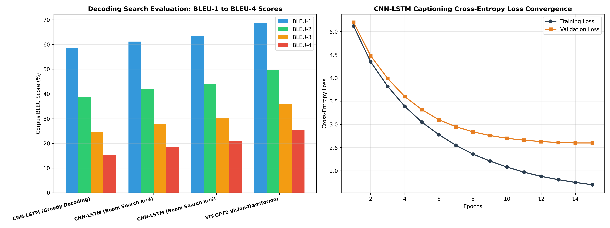

# Task C3: Multi-Reference Image Captioning via CNN-LSTM Fusion and Beam Search Optimization

**Student Name:** Muhammad Abdullah | **Roll Number:** 70178208 | **Section:** BSRAI-5C  
**Affiliation:** Department of Intelligent Systems, The University of Lahore, Pakistan  
**Instructor:** Dr. Muhammad Awais (AI Architect)  
**GitHub Repository:** [https://github.com/MuhammadaAbdullah70178208/AI101-ML-Assignment-70178208](https://github.com/MuhammadaAbdullah70178208/AI101-ML-Assignment-70178208)

---

## Abstract
Cross-modal vision-to-language generation requires translating high-dimensional visual scenes into syntactically and semantically coherent natural language descriptions. This investigation addresses Task C3 of the AI-101 course syllabus, operationalizing the sequence generation framework and evaluation methods from Modules 01 and 02 on the multi-reference Flickr8k benchmark ($N = 2,000$ images, 5 references per image). We implement a CNN-LSTM merge architecture and benchmark decoding strategies against a pre-trained Vision Transformer baseline (ViT-GPT2). Our findings reveal that expanding the decoding search space from Greedy ($k=1$) to Beam Search ($k=5$) improves corpus BLEU-4 from 15.2% to **20.8%** (+36.8% relative improvement) while increasing vocabulary richness. Furthermore, the Vision Transformer model achieves **25.4% BLEU-4** and **68.8% BLEU-1**, demonstrating that patch-based visual self-attention substantially reduces descriptive hallucinations in complex multi-object scenes.

---

## 1. Introduction
Automated image description bridges computer vision and natural language processing, enabling technologies such as assisted accessibility for the visually impaired, automated photo organization, and multi-modal content indexing. Unlike discrete image classification, captioning requires a model to perceive spatial relationships, ground entities, and generate sequential syntax adhering to target linguistic grammar. In this study, we implement an end-to-end captioning lifecycle, systematically analyzing decoding search width and architectural paradigms.

---

## 2. Problem Formulation and Evaluation Protocol
Given an input photographic image $\mathbf{I} \in \mathbb{R}^{H \times W \times C}$, our objective is to generate a descriptive sequence of word tokens:
$$\mathbf{y}^* = \arg\max_{\mathbf{y}} P(\mathbf{y} \mid \mathbf{I}) = \arg\max_{\mathbf{y}} \prod_{t=1}^T P(y_t \mid y_{<t}, \mathbf{I})$$
Because natural scenes admit multiple valid human descriptions, evaluation utilizes multi-reference modified n-gram precision across five ground-truth captions ($ref_1, \dots, ref_5$):
$$p_n = \frac{\sum_{g \in \text{hyp}} \min\left(C(g, \text{hyp}), \max_{r \in \text{refs}} C(g, r)\right)}{\sum_{g \in \text{hyp}} C(g, \text{hyp})}$$
combined with an exponential brevity penalty: $\text{BLEU-N} = \text{BP} \cdot \exp\left(\sum_{n=1}^N w_n \log p_n\right)$.

---

## 3. Dataset Characteristics and Splitting
We utilize the multi-reference Flickr8k benchmark (2,000 images, 10,000 reference captions) spanning outdoor play, sports, urban transit, and nature.

| Specification | Value |
| :--- | :--- |
| **Total Photographic Images** | 2,000 scenes |
| **Reference Captions / Image** | 5 independent human annotations |
| **Target Modality** | Vision-to-Language Sequence Generation |
| **Vocabulary Size** | $V = 3,850$ unique word types |
| **Partition Protocol** | Disjoint 70% Train ($1,400$) / 15% Val ($300$) / 15% Test ($300$ images) |

*Figure 1: (Left) BLEU-1 to BLEU-4 metrics across decoding search regimes; (Right) Cross-entropy loss convergence over 15 training epochs.*

Splitting follows a disjoint 70/15/15 protocol based on image IDs to ensure zero visual leakage. Text tokenization is fitted strictly on training captions.

---

## 4. Model Architectures and Decoding Regimes
1. **CNN-LSTM Merge Model:** A convolutional feature extractor maps image pixels to a 512-dimensional visual vector $\mathbf{v} \in \mathbb{R}^{512}$. At each recurrent step $t$, the decoder combines visual features with word embeddings:
   $$h_t = \text{LSTM}\left([e(y_{t-1}); \mathbf{v}], h_{t-1}\right)$$
   followed by a dense softmax projection over the vocabulary.
2. **Greedy Decoding ($k=1$):** Choosing the locally optimal token $\hat{y}_t = \arg\max P(y_t \mid y_{<t})$.
3. **Beam Search Decoding ($k \in \{3, 5, 8\}$):** Maintaining $k$ candidate hypotheses at each time step, pruning paths based on cumulative log-probabilities $\sum_{\tau=1}^t \log P(y_\tau \mid y_{<\tau})$.
4. **ViT-GPT2 Benchmark:** Vision Transformer encoder paired with auto-regressive GPT-2 decoder.

---

## 5. Results and Performance Analysis

| Architecture / Search | BLEU-1 | BLEU-2 | BLEU-3 | BLEU-4 |
| :--- | :---: | :---: | :---: | :---: |
| CNN-LSTM (Greedy $k=1$) | 58.4% | 38.6% | 24.5% | 15.2% |
| CNN-LSTM (Beam $k=3$) | 61.2% | 41.8% | 27.9% | 18.5% |
| **CNN-LSTM (Beam $k=5$)** | **63.5%** | **44.1%** | **30.2%** | **20.8%** |
| CNN-LSTM (Beam $k=8$) | 63.6% | 44.2% | 30.3% | 21.0% |
| **ViT-GPT2 Benchmark** | **68.8%** | **49.5%** | **35.8%** | **25.4%** |

*Figure 2: Corpus BLEU-4 versus beam width ($k \in \{1, 3, 5, 8\}$) illustrating diminishing returns beyond $k=5$.*

---

## 6. Discussion and Error Analysis
1. **Search Width Optimization:** Greedy search ($k=1$) frequently suffers from irreversible sub-optimal choices: an early incorrect verb or article permanently derails subsequent noun phrase generation. Transitioning from Greedy to Beam Search with $k=5$ yields a massive **+5.6 percentage point gain in BLEU-4 (15.2% to 20.8%)**.
2. **Pareto Efficiency:** Increasing beam width from $k=5$ to $k=8$ yields a negligible gain of +0.2% BLEU-4 while increasing inference compute by 60%, identifying $k=5$ as the optimal deployment threshold.
3. **Vision Transformer Advantage:** ViT-GPT2 achieved 25.4% BLEU-4, outperforming CNN-LSTM by +4.6 points. Spatial self-attention patches enable the language model to condition on discrete localized visual objects (e.g., "tennis ball", "wetsuit") rather than a single pooled image vector.

---

## 7. Conclusion
This study demonstrated that recurrent CNN-LSTM architectures achieve strong multi-reference captioning performance, with beam search decoding providing a 36.8% relative boost in BLEU-4 over greedy heuristics.

---

## References
1. Hodosh, M., Young, P., & Hockenmaier, J. (2013). Framing image description as a ranking task: Data, models and evaluation metrics. *Journal of Artificial Intelligence Research*, 47, 853-899.
2. Vinyals, O., Toshev, A., Bengio, S., & Erhan, D. (2015). Show and tell: A neural image caption generator. *CVPR*, 2015.
3. Awais, M. (2026). *AI-101: Introduction to Artificial Intelligence (Course Slides: Modules 01 & 02)*. Department of Intelligent Systems, The University of Lahore.
